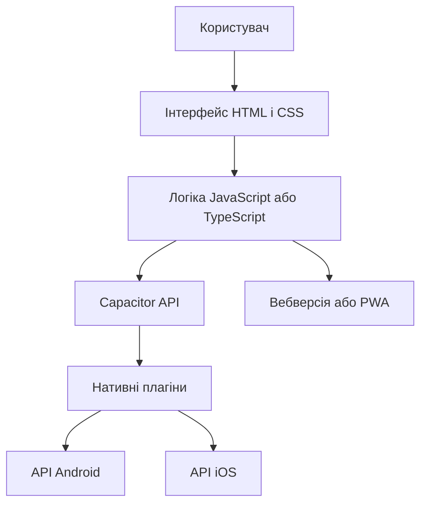
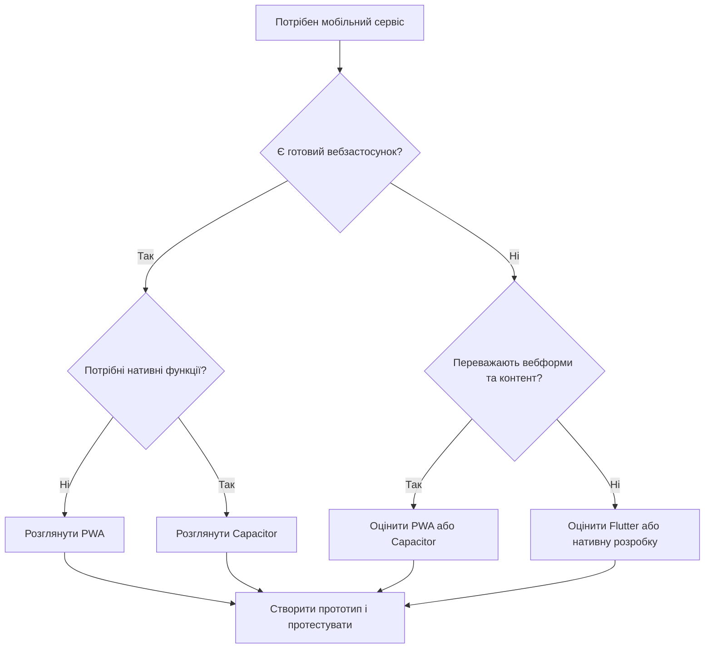
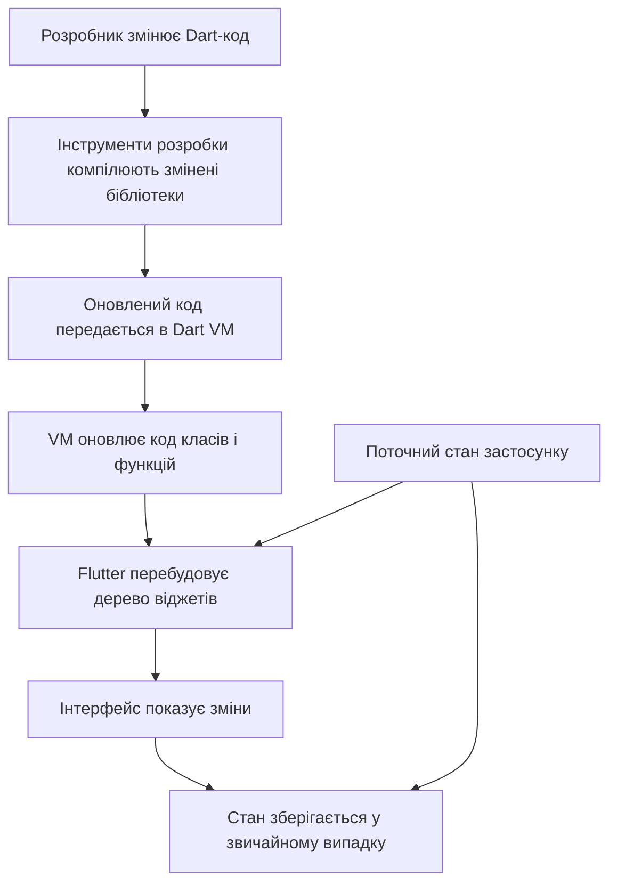
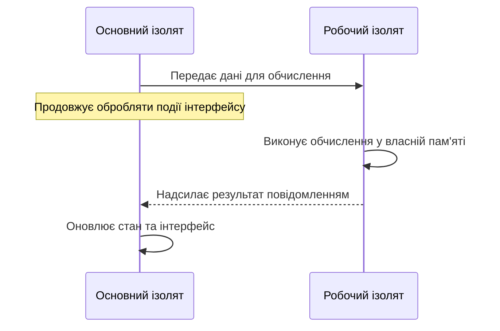
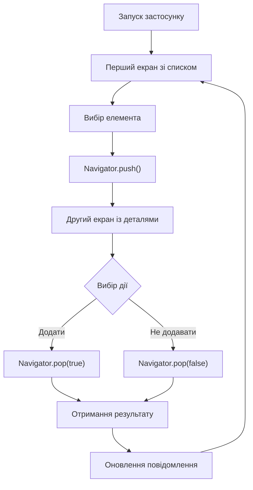
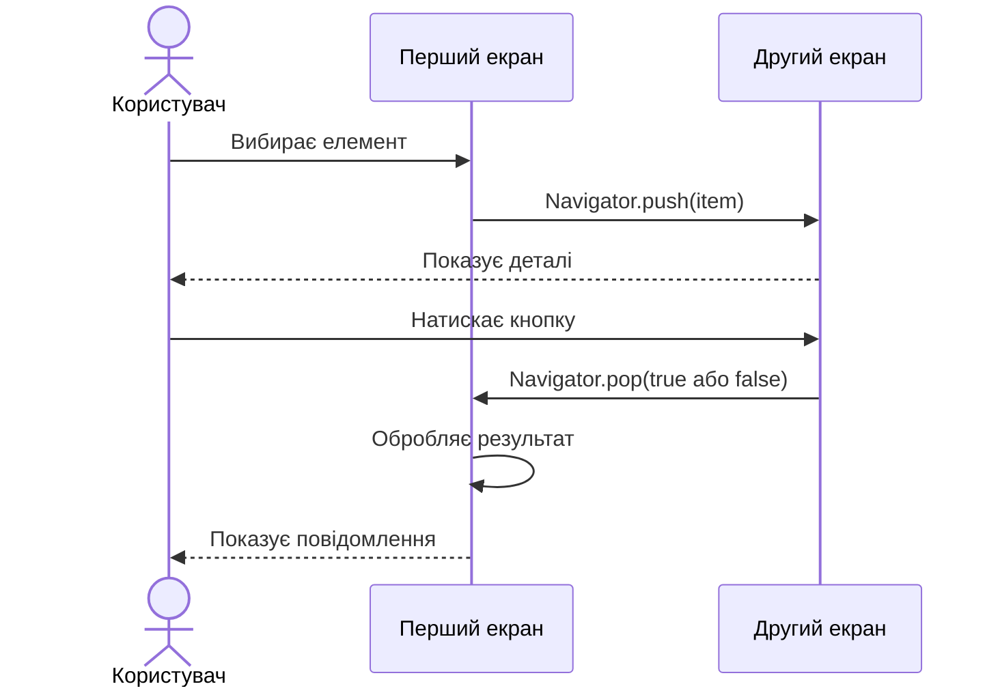

# Практична робота № 1
## Загальний огляд мобільних платформ

**Дисципліна:** Програмування для мобільних платформ  
**Варіант 5:** Гібридний підхід — коли він доречний

## 1. Мета роботи

Мета роботи — дослідити особливості гібридної мобільної розробки, визначити завдання, для яких цей підхід є доцільним, порівняти його з Flutter та сформулювати критерії вибору технології для мобільного застосунку.

## 2. Що таке гібридна мобільна розробка

Гібридна мобільна розробка передбачає використання вебтехнологій, зокрема HTML, CSS і JavaScript, для створення інтерфейсу та логіки застосунку. Такий інтерфейс може працювати всередині WebView — компонента, який відображає вебвміст у мобільному застосунку.

Для доступу до функцій пристрою, наприклад камери, геолокації чи сповіщень, можуть використовуватися спеціальні плагіни. Один із прикладів такого рішення — Capacitor.

Варто розрізняти три поняття:

- **WebView-застосунок** — вебінтерфейс, який відображається у вбудованому браузері.
- **PWA (Progressive Web App)** — вебзастосунок із можливостями, які залежать від браузера та операційної системи. Він може підтримувати встановлення на пристрій і роботу офлайн за відповідної реалізації.
- **Capacitor** — інструмент, який дає змогу використовувати вебтехнології в мобільному застосунку та звертатися до нативних можливостей через плагіни.

Отже, гібридний підхід дає змогу повторно використовувати значну частину вебкоду, але не усуває потреби тестувати застосунок на різних мобільних платформах.

## 3. Архітектура гібридного застосунку

Типовий гібридний застосунок складається з інтерфейсу, логіки, шару взаємодії з платформою та нативних функцій пристрою.

### 3.1. Схема роботи



**Пояснення до діаграми:**

1. Користувач взаємодіє з інтерфейсом застосунку.
2. HTML і CSS відповідають за структуру та оформлення елементів.
3. JavaScript або TypeScript реалізує логіку, перевірку даних і взаємодію з сервером.
4. Capacitor забезпечує зв'язок між вебкодом і можливостями мобільної платформи.
5. Плагіни дають змогу звертатися до доступних нативних функцій Android та iOS.

Не кожна функція обов'язково проходить через нативний плагін. Наприклад, звичайна вебформа може працювати без нього.

## 4. Коли гібридний підхід доречний

### 4.1. Завдання, для яких він підходить

| Клас завдань | Приклад | Чому гібридний підхід доречний |
|---|---|---|
| Каталоги та інформаційні сервіси | Каталог товарів, меню кафе, довідник | Основу становлять текст, зображення, списки та запити до сервера |
| Корпоративні застосунки | Внутрішній портал, перегляд звітів | Можна повторно використовувати вебінтерфейс і спільну бізнес-логіку |
| Форми та облік даних | Реєстрація, заявки, анкети | Такі сценарії зазвичай не потребують складної графіки |
| Сервіси з помірним доступом до пристрою | Фото до заявки, геолокація, сповіщення | Потрібні нативні функції, але їх можна підключати через плагіни |

Гібридний підхід особливо вигідний, коли вже існує вебзастосунок або вебкоманда, а мобільна версія має повторювати основні сценарії. У такому випадку частину коду, стилів і логіки можна використати повторно.

### 4.2. Завдання, для яких він менш доречний

| Клас завдань | Приклад | Чому гібридний підхід може не підійти |
|---|---|---|
| Ігри зі складною 3D-графікою | Гонки, масштабні 3D-сцени | Можуть знадобитися спеціалізований графічний рушій та точний контроль продуктивності |
| Застосунки з дуже високими вимогами до швидкодії | Обробка відео в реальному часі, складні обчислення | Додатковий шар взаємодії та особливості вебсередовища можуть ускладнити оптимізацію |
| Глибока інтеграція з операційною системою | Спеціалізовані системні служби, складна робота з обладнанням | Може знадобитися багато власного нативного коду або функції, яких немає у готових плагінах |

Це не означає, що будь-яку таку програму неможливо створити гібридними засобами. Рішення залежить від конкретних вимог, доступних API та результатів тестування прототипу.

## 5. Порівняння гібридного підходу та Flutter

Flutter — це набір інструментів для створення застосунків із використанням мови Dart. На відміну від типового гібридного рішення на основі WebView, Flutter використовує власну систему побудови інтерфейсу.

| Критерій | Гібридний підхід (Capacitor) | Flutter |
|---|---|---|
| Основні технології | HTML, CSS, JavaScript або TypeScript | Dart і Flutter |
| Продуктивність | Залежить від складності вебінтерфейсу, WebView і плагінів | Дає змогу будувати інтерфейс без типового WebView-шару; швидкодію все одно потрібно вимірювати |
| Доступ до API пристрою | Через Capacitor API та плагіни; для окремих можливостей може знадобитися нативний код | Через плагіни Flutter або власний платформний код |
| Повторне використання вебкоду | Високе, якщо вже є вебзастосунок | Вебінтерфейс зазвичай потрібно реалізовувати засобами Flutter |
| Витрати на підтримку | Можуть бути нижчими за наявності вебкоманди й спільної кодової бази | Потрібні знання Dart і Flutter; перевагою є спільна кодова база для підтримуваних платформ |
| Інтерфейс | HTML/CSS, залежність від WebView та реалізації стилів | Віджети Flutter забезпечують узгоджений вигляд інтерфейсу |
| Коли обирати | Коли важливо використати наявний вебкод | Коли потрібен окремо побудований мобільний інтерфейс і контроль над його поведінкою |

**Важливо:** не можна стверджувати, що одна технологія завжди швидша за іншу. Результат залежить від пристрою, архітектури, складності інтерфейсу та якості реалізації.

### 5.1. Як перевіряти продуктивність

Для об'єктивного порівняння слід створити прототипи з однаковими функціями та перевірити їх на тих самих пристроях.

Рекомендовані показники:

- час запуску застосунку;
- плавність прокручування списків та анімацій;
- використання оперативної пам'яті;
- розмір інсталяційного пакета;
- стабільність роботи під час тривалого використання.

Порівнювати потрібно не лише технології, а й конкретні реалізації. Результати тестування варто записати в таблицю, зазначивши пристрій, версію операційної системи та умови перевірки.

## 6. Алгоритм вибору технології

### 6.1. Схема прийняття рішення



Діаграма є спрощеною моделлю вибору. Остаточне рішення потрібно приймати після уточнення вимог, перевірки потрібних API та тестування на цільових пристроях.

### 6.2. Чекліст: чи варто обирати гібридний підхід?

Гібридний підхід доцільно обирати, якщо на всі п'ять запитань можна відповісти «так».

| № | Контрольне запитання | Умова для відповіді «так» |
|---|---|---|
| 1 | Чи можна реалізувати основні сценарії вебтехнологіями? | Основу становлять форми, списки, контент і взаємодія із сервером |
| 2 | Чи важливе повторне використання вебкоду? | Уже є вебзастосунок або команда з відповідними навичками |
| 3 | Чи доступні потрібні функції пристрою? | Необхідні API підтримуються Capacitor або їх можна реалізувати власним плагіном |
| 4 | Чи відповідає продуктивність вимогам? | Прототип проходить тестування на цільових пристроях |
| 5 | Чи прийнятні обмеження WebView і плагінів? | Команда готова тестувати сумісність та підтримувати залежності |

Якщо хоча б на одне критично важливе запитання відповідь «ні», варто переглянути архітектуру або порівняти гібридний підхід із Flutter чи нативною розробкою.

## 7. Ризики та обмеження

| Ризик | Можливий наслідок | Як зменшити ризик |
|---|---|---|
| Відмінності WebView на пристроях | Інтерфейс може поводитися по-різному | Тестувати на різних версіях Android та iOS |
| Обмеження плагінів | Потрібна додаткова нативна реалізація | Перевіряти доступність API до початку розробки |
| Продуктивність складного інтерфейсу | Затримки анімацій або прокручування | Профілювати застосунок і спрощувати вузькі місця |
| Оновлення залежностей | Можливі проблеми сумісності | Фіксувати версії, перевіряти оновлення та автоматизувати тести |
| Вимоги магазинів застосунків | Публікація може потребувати додаткових змін | Перевіряти актуальні правила Google Play та App Store |

Основний ризик обраного підходу — залежність від WebView і плагінів. Його можна зменшити, якщо заздалегідь перевірити найважливіші функції на реальних пристроях і не відкладати тестування до завершення проєкту.

## 8. Висновок

Для мобільного сервісу, який переважно складається з форм, каталогів, особистого кабінету та взаємодії із сервером, **доцільно обрати гібридний підхід на основі Capacitor**, якщо вже є вебкод або команда, що володіє вебтехнологіями.

Рішення ґрунтується на трьох аргументах:

1. **Повторне використання коду:** можна застосувати наявні HTML, CSS і JavaScript або TypeScript.
2. **Доступ до мобільних можливостей:** Capacitor надає механізм роботи з нативними API через плагіни.
3. **Підтримка проєкту:** спільна вебкодова база може зменшити дублювання логіки та витрати на її оновлення.

Водночас головний ризик — відмінності WebView, обмеження плагінів і можливі проблеми продуктивності. Тому перед повною розробкою потрібно створити прототип, перевірити потрібні API та виміряти продуктивність на цільових пристроях.

Якщо ж застосунок потребує складної графіки, високої продуктивності або специфічної системної інтеграції, варто розглянути Flutter чи нативну розробку.

## 9. Джерела інформації

1. Capacitor — офіційна документація: https://capacitorjs.com/docs
2. Capacitor — налаштування середовища розробки: https://capacitorjs.com/docs/getting-started/environment-setup
3. Capacitor — Progressive Web Apps: https://capacitorjs.com/docs/web/progressive-web-apps
4. Flutter — продуктивність застосунків: https://docs.flutter.dev/perf
5. Flutter — архітектура застосунків: https://docs.flutter.dev/app-architecture
6. MDN Web Docs — Progressive Web Apps: https://developer.mozilla.org/en-US/docs/Web/Progressive_web_apps

**Дата звернення до джерел:** 21.10.2026.

Інформація в роботі узагальнена за офіційною документацією зазначених технологій. Оцінки продуктивності та витрат на підтримку залежать від конкретного проєкту й мають перевірятися на практиці.


# Практична робота № 2
## Технологія Flutter

**Дисципліна:** Програмування для мобільних платформ  
**Варіант 5:** Чому саме Dart

## 1. Мета роботи

Дослідити технічні особливості мови Dart, завдяки яким вона підходить для розробки мобільних застосунків у Flutter. Розглянути JIT- і AOT-компіляцію, механізм гарячого перезавантаження, модель ізолятів і керування пам'яттю. Визначити переваги та обмеження такого підходу.

## 2. JIT та AOT-компіляція

Компіляція — це перетворення програмного коду у форму, яку може виконувати відповідне середовище. У Dart використовуються різні режими компіляції залежно від етапу роботи над програмою.

**JIT (Just-In-Time)** — компіляція під час виконання. У режимі розробки Dart VM може завантажувати зміни коду без повної повторної збірки всього застосунку. Це підтримує швидкий цикл редагування, перевірки та налагодження.

**AOT (Ahead-Of-Time)** — компіляція до запуску програми. Для нативних мобільних збірок Dart-код заздалегідь компілюється в машинний код. Це дає змогу запускати готовий застосунок без виконання основного коду через JIT-компілятор під час роботи.

### Таблиця 1. Порівняння JIT та AOT

| Критерій | JIT | AOT |
|---|---|---|
| Коли виконується компіляція | Під час виконання програми | До запуску готового застосунку |
| Основне призначення у Flutter | Розробка та налагодження | Релізна збірка |
| Зміна коду під час роботи | Підтримує швидке завантаження змін у режимі розробки | Зміни потребують повторної збірки |
| Перевага | Швидкий цикл розробки | Передбачуваний запуск і виконання скомпільованого коду |
| Обмеження | Не є типовим режимом виконання релізної мобільної збірки | Не призначений для звичайного гарячого перезавантаження релізного застосунку |

Офіційна документація Dart описує компіляцію та виконання програм у різних режимах:

- https://dart.dev/overview
- https://dart.dev/tools/dart-compile

## 3. Гаряче перезавантаження (Hot Reload)

Hot Reload дає змогу побачити зміни коду без повного перезапуску застосунку. Під час розробки змінені бібліотеки передаються до Dart VM, після чого Flutter перебудовує дерево віджетів.

Важлива особливість — **стан застосунку зазвичай зберігається**. Наприклад, якщо користувач уже відкрив певний екран і ввів текст у поле, зміна кольору кнопки зазвичай не змусить його проходити весь сценарій повторно.

Hot Reload не є універсальним: деякі зміни, зокрема зміни нативного коду або певних структур типів, вимагають Hot Restart чи повного перезапуску.

### Діаграма 1. Механізм Hot Reload



Діаграма показує, що оновлення коду та збереження стану — різні процеси. Flutter оновлює інтерфейс, але за звичайного Hot Reload не запускає `main()` і `initState()` повторно.

Джерело: https://docs.flutter.dev/tools/hot-reload

## 4. Модель ізолятів у Dart

Ізолят (isolate) — незалежне середовище виконання Dart зі своєю пам'яттю та циклом подій. Основний ізолят зазвичай обробляє події інтерфейсу. Якщо застосунок виконує довге обчислення в цьому самому ізоляті, обробка натискань і оновлення екрана можуть затримуватися.

Для важких обчислень можна використати окремий ізолят. Він виконує роботу незалежно від основного та передає результат повідомленнями. Оскільки ізоляти не мають спільного змінюваного стану, між ними не виникають класичні гонки даних, спричинені одночасним доступом до спільної пам'яті.

Однак ізоляти не усувають усі можливі помилки конкурентного програмування. Наприклад, неправильний порядок повідомлень або помилки в логіці самого алгоритму все ще можливі.

### Таблиця 2. Основний ізолят та робочий ізолят

| Ознака | Основний ізолят | Робочий ізолят |
|---|---|---|
| Типова роль | Інтерфейс, події користувача | Важкі обчислення у фоновому режимі |
| Пам'ять | Власна | Окрема |
| Спільний змінюваний стан з іншим ізолятом | Ні | Ні |
| Обмін даними | Надсилає та отримує повідомлення | Надсилає та отримує повідомлення |
| Приклад застосування | Обробка натискання кнопки | Аналіз великого JSON або обробка зображення |

### Діаграма 2. Взаємодія ізолятів



Для разового обчислення Dart пропонує `Isolate.run()`. Цей механізм корисний, наприклад, для обробки великих наборів даних, щоб не блокувати основний ізолят.

Джерела:

- https://dart.dev/language/concurrency
- https://dart.dev/language/isolates

## 5. Збирач сміття та короткоживучі об'єкти

Під час побудови інтерфейсу Flutter створює багато об'єктів: віджети, допоміжні структури та проміжні значення. Частина таких об'єктів потрібна лише на короткий час.

Dart використовує керування пам'яттю та збирач сміття (Garbage Collector, GC), який звільняє пам'ять, зайняту об'єктами, що більше не використовуються. Генераційний підхід до збирання сміття дає змогу ефективно обробляти об'єкти з різним часом життя, зокрема численні короткоживучі об'єкти.

Це важливо для інтерфейсу, який часто перебудовується. Розробнику не потрібно вручну звільняти пам'ять для кожного тимчасового об'єкта.

Водночас GC не гарантує відсутності затримок. Надмірні виділення пам'яті, утримання непотрібних посилань або надто важкі обчислення все ще можуть погіршити продуктивність. Тому важливо перевіряти реальну поведінку застосунку за допомогою Flutter DevTools, а не робити висновки лише з мови програмування.

Джерело: https://dart.dev/overview

## 6. Порівняння Dart із мовою-альтернативою

Як альтернативу розглянемо JavaScript, який широко використовується для вебзастосунків. Обидві мови мають автоматичне керування пам'яттю, а JavaScript також підтримує фонову роботу через Web Workers. Тому некоректно стверджувати, що тільки Dart може виконувати фонові обчислення.

Перевага Dart у контексті Flutter полягає в поєднанні інструментів мови, Dart VM, Hot Reload і нативної AOT-компіляції в межах одного технологічного середовища.

### Таблиця 3. Порівняння Dart і JavaScript

| Властивість | Dart у Flutter | JavaScript у браузері |
|---|---|---|
| Швидкий цикл розробки | Hot Reload у підтримуваному режимі Flutter | Швидке оновлення сторінки або модулів залежно від інструментів |
| Гаряче перезавантаження зі збереженням стану | Вбудований механізм Flutter з визначеними обмеженнями | Залежить від середовища та інструментів розробки |
| Фонова робота | Ізоляти на нативних платформах; на вебі — інші механізми | Web Workers |
| Автоматичне керування пам'яттю | Є збирач сміття | Є збирач сміття |
| Нативна компіляція для мобільного застосунку Flutter | Підтримується AOT-компіляцією Dart | Типовий браузерний JavaScript виконується в JavaScript-рушії; модель компіляції інша |

**Якої властивості бракує альтернативі?** У JavaScript у браузері немає того самого вбудованого в Flutter/Dart VM циклу Hot Reload, який оновлює Dart-код і перебудовує Flutter-інтерфейс зі збереженням стану. Це не означає, що JavaScript не має інструментів гарячого оновлення: їхня поведінка залежить від конкретного середовища.

## 7. Висновки

Під час роботи я з'ясував, що вибір Dart для Flutter обґрунтований не однією властивістю, а поєднанням механізмів, які підтримують різні етапи створення застосунку.

1. JIT-компіляція допомагає швидко перевіряти зміни під час розробки, а AOT-компіляція використовується для створення нативних релізних збірок.
2. Hot Reload оновлює код та інтерфейс без звичайного повного перезапуску, зберігаючи поточний стан у типових випадках.
3. Ізоляти дозволяють винести важкі обчислення з основного ізоляту й зменшити ризик блокування інтерфейсу через такі обчислення.
4. Збирач сміття автоматизує звільнення пам'яті, але не замінює аналіз продуктивності.

Головне, що я зрозумів додатково: **продуктивність не забезпечується автоматично самою мовою**. Вона залежить від того, де виконуються обчислення, скільки пам'яті виділяється, як побудовано інтерфейс і чи перевірено застосунок у реальних умовах.

## 8. Список джерел

1. Dart overview — https://dart.dev/overview
2. Dart compilation — https://dart.dev/tools/dart-compile
3. Flutter Hot Reload — https://docs.flutter.dev/tools/hot-reload
4. Concurrency in Dart — https://dart.dev/language/concurrency
5. Isolates — https://dart.dev/language/isolates

# Практична робота № 3: Hello World в Flutter

**Дисципліна:** Програмування для мобільних платформ  
**Тема:** Hello World в Flutter  
**Варіант:** 5 — Багатоекранний застосунок  
**Тривалість:** 2 академічні години  
**Максимальний бал:** 6 балів

## 1. Мета роботи

Розгорнути робоче середовище Flutter, створити перший застосунок, навчитися переходити між екранами, передавати дані між ними, використовувати Hot Reload та базові інструменти налагодження.

## 2. Завдання роботи

Необхідно створити багатоекранний застосунок, який містить два екрани та забезпечує передавання результату між ними.

Функціональні вимоги:
1. Перший екран містить список із 5–7 елементів.
2. Натискання на елемент відкриває другий екран із детальною інформацією.
3. Другий екран повертає результат, наприклад повідомлення про додавання елемента в обране.
4. Перший екран отримує результат і показує його користувачу.
5. Для навігації використовуються `Navigator.push()` та `Navigator.pop()`.
6. Кожен екран розміщується в окремому файлі.

## 3. Опис розробленого застосунку

Було спроєктовано багатоекранний застосунок-каталог, присвячений технологіям Flutter.

На першому екрані розміщується список із шести елементів:
- Flutter;
- Dart;
- Material Design;
- Hot Reload;
- Widget;
- Navigator.

Користувач може натиснути на будь-який елемент і перейти до другого екрана. На ньому відображається назва елемента, його опис і дві кнопки: «Додати в обране» та «Повернутися без додавання».

Після натискання однієї з кнопок застосунок повертається на перший екран і показує результат дії.

## 4. Структура проєкту

```text
hello_flutter_lab3/
├── lib/
│   ├── main.dart
│   ├── models/
│   │   └── item.dart
│   └── screens/
│       ├── home_screen.dart
│       └── detail_screen.dart
├── docs/
│   ├── flutter-doctor.png
│   ├── app-emulator.png
│   └── app-device.png
├── pubspec.yaml
├── .gitignore
└── README.md
```

Файл `main.dart` є точкою входу в застосунок. Файл `item.dart` містить модель даних. Файли `home_screen.dart` та `detail_screen.dart` відповідають за перший і другий екрани відповідно.

Такий поділ спрощує підтримку коду та дає змогу розділити логіку різних частин програми.

## 5. Алгоритм роботи застосунку



## 6. Передавання даних між екранами

Для переходу між екранами використовується `Navigator.push()`. Цей метод відкриває новий екран і дає змогу передати йому вибраний елемент.

Для повернення результату використовується `Navigator.pop()`. Другий екран може повернути значення `true`, якщо елемент додано в обране, або `false`, якщо користувач відмовився від цієї дії.

Перший екран очікує на результат за допомогою `await` і після повернення оновлює повідомлення через `setState()`.



### Приклад навігації

```dart
final result = await Navigator.push<bool>(
  context,
  MaterialPageRoute<bool>(
    builder: (context) => DetailScreen(item: item),
  ),
);

if (!mounted) return;

if (result == true) {
  setState(() {
    message = 'Елемент додано в обране!';
  });
}
```

У цьому прикладі перший екран очікує на результат переходу. Перевірка `mounted` потрібна, щоб не оновлювати стан віджета, який уже було видалено з дерева віджетів.

Приклад демонструє основний механізм навігації; назви класів і змінних мають відповідати реалізації проєкту.

## 7. Hot Reload

Hot Reload — це інструмент Flutter, який дає змогу застосовувати багато змін у вихідному коді без повного перезапуску застосунку.

Під час розробки можна змінити текст заголовка, зберегти файл і перевірити результат. У багатьох випадках поточний стан віджетів зберігається.

| Дія | Очікуваний результат |
|---|---|
| Зміна тексту заголовка | Новий текст відображається після Hot Reload |
| Зміна кольору елемента | Інтерфейс оновлюється |
| Додавання віджета | Новий віджет з'являється після оновлення |
| Повний перезапуск | Застосунок запускається заново |

Для перевірки Hot Reload потрібно запустити застосунок командою `flutter run`, змінити текст у коді та зберегти файл. У терміналі можна натиснути `r`, щоб виконати Hot Reload.

## 8. Перевірка працездатності

Для перевірки проєкту використовуються такі команди:

```bash
flutter doctor
flutter pub get
flutter analyze
flutter devices
flutter run
```

| Перевірка | Очікуваний результат |
|---|---|
| `flutter doctor` | Середовище готове для цільової платформи |
| `flutter pub get` | Залежності проєкту завантажено |
| `flutter analyze` | Відсутні помилки аналізатора |
| `flutter devices` | Відображається доступний емулятор або пристрій |
| `flutter run` | Застосунок запускається |
| Перехід між екранами | Відкривається екран деталей |
| Повернення результату | Перший екран показує повідомлення |

Фактичні результати перевірок необхідно отримати під час запуску проєкту.

## 9. Можливі труднощі та їх розв'язання

**Проблема 1. Flutter не розпізнається терміналом.**

Причина: шлях до Flutter SDK не додано до змінної середовища `PATH`.

Розв'язання: перевірити налаштування Flutter SDK і перезапустити термінал.

**Проблема 2. Немає доступного пристрою.**

Причина: емулятор не запущений або телефон не під'єднаний.

Розв'язання: запустити Android Emulator або під'єднати телефон із дозволеним USB debugging.

**Проблема 3. Помилки залежностей.**

Розв'язання: виконати команду `flutter pub get`.

**Проблема 4. Попередження аналізатора.**

Розв'язання: виконати `flutter analyze` та виправити повідомлення, які він виводить.

## 10. Документація та скриншоти

У каталозі `docs/` потрібно зберегти такі скриншоти:

1. `flutter-doctor.png` — результат перевірки `flutter doctor`.
2. `app-emulator.png` — працюючий застосунок на емуляторі.
3. `app-device.png` — працюючий застосунок на фізичному пристрої, якщо він доступний.

Скриншоти необхідно зробити під час фактичного запуску програми. Вони підтверджують працездатність застосунку та налаштування середовища.

## 11. Висновок

Під час виконання практичної роботи розглянуто створення багатоекранного застосунку на Flutter. Було визначено структуру проєкту, принципи поділу коду на файли та механізм передавання результатів між екранами за допомогою `Navigator.push()` і `Navigator.pop()`.

Також розглянуто призначення Hot Reload та команди для перевірки середовища й аналізу коду. Отримані знання дають змогу створювати застосунки з декількома екранами та організовувати взаємодію між ними.

## 12. Джерела

1. Flutter Documentation — https://docs.flutter.dev/
2. Flutter: Navigate to a new screen and back — https://docs.flutter.dev/cookbook/navigation/navigation-basics
3. Flutter: Send data to a new screen — https://docs.flutter.dev/cookbook/navigation/passing-data
4. Flutter: Return data from a screen — https://docs.flutter.dev/cookbook/navigation/returning-data
5. Flutter: Hot Reload — https://docs.flutter.dev/tools/hot-reload
Практична робота 6.1 — Базовий State Management у Flutter

Тема: Управління станом у Flutter.

Мета роботи: Навчитися працювати зі станом віджетів, використовувати StatefulWidget, setState() та оновлювати інтерфейс застосунку відповідно до змін даних.

Реалізовано:

Лічильник із поточним значенням.

Збільшення та зменшення значення.

Скидання лічильника.

Історія змін значення.

Оновлення інтерфейсу за допомогою setState().

Технології: Flutter, Dart.

Перевірка: flutter analyze — помилок не виявлено.

Запуск: flutter run -d chrome.
Практична робота 6.2 — Provider State Management

Тема: Управління станом за допомогою Provider
Варіант 2: Авторизація та профіль користувача

Мета роботи

Навчитися використовувати Provider для управління станом Flutter-застосунку, реалізувати авторизацію користувача та редагування профілю за допомогою ChangeNotifier.

Реалізований функціонал

Авторизація з перевіркою email і пароля.

Валідація полів форми.

Імітація асинхронного входу з індикатором завантаження.

Обробка неправильних облікових даних.

Відображення профілю користувача.

Редагування і збереження даних профілю.

Вихід з облікового запису.

Управління станом за допомогою Provider, MultiProvider, ChangeNotifier, Consumer і Selector.

Тестові дані

Email: student@example.com

Пароль: flutter123

Авторизація імітується локально, без підключення до сервера.

Запуск

Перейти до папки provider_auth_lab і виконати:

flutter pub get
flutter analyze
flutter run -d chrome

Висновок

Реалізовано Flutter-застосунок для авторизації та управління профілем користувача.
 Отримано практичні навички використання Provider для управління станом, роботи з ChangeNotifier, валідації форм та оновлення даних інтерфейсу.