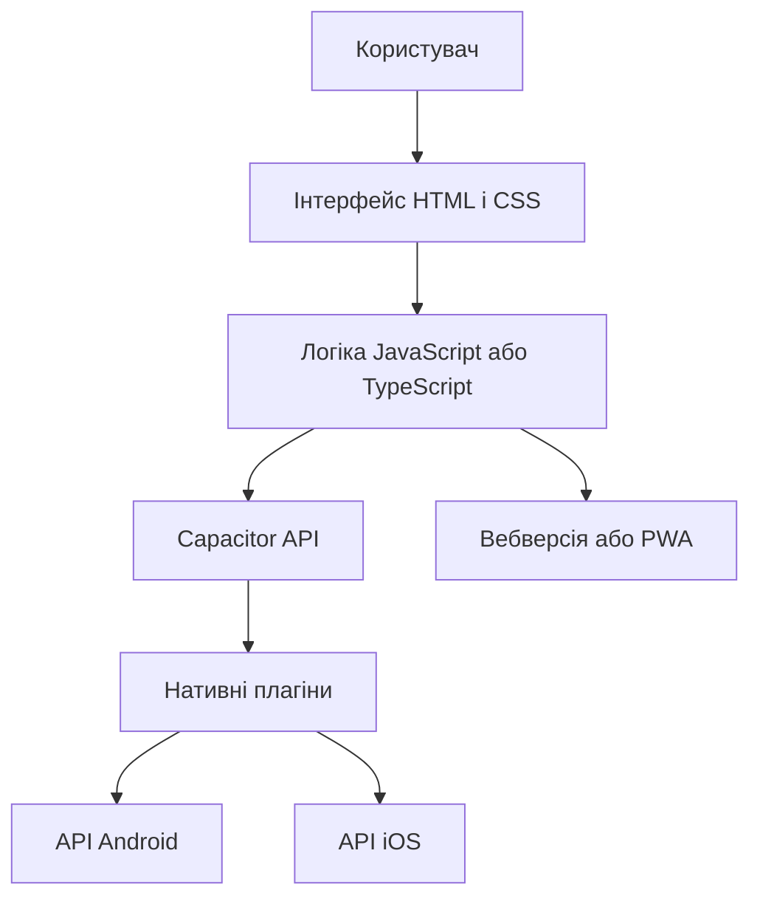
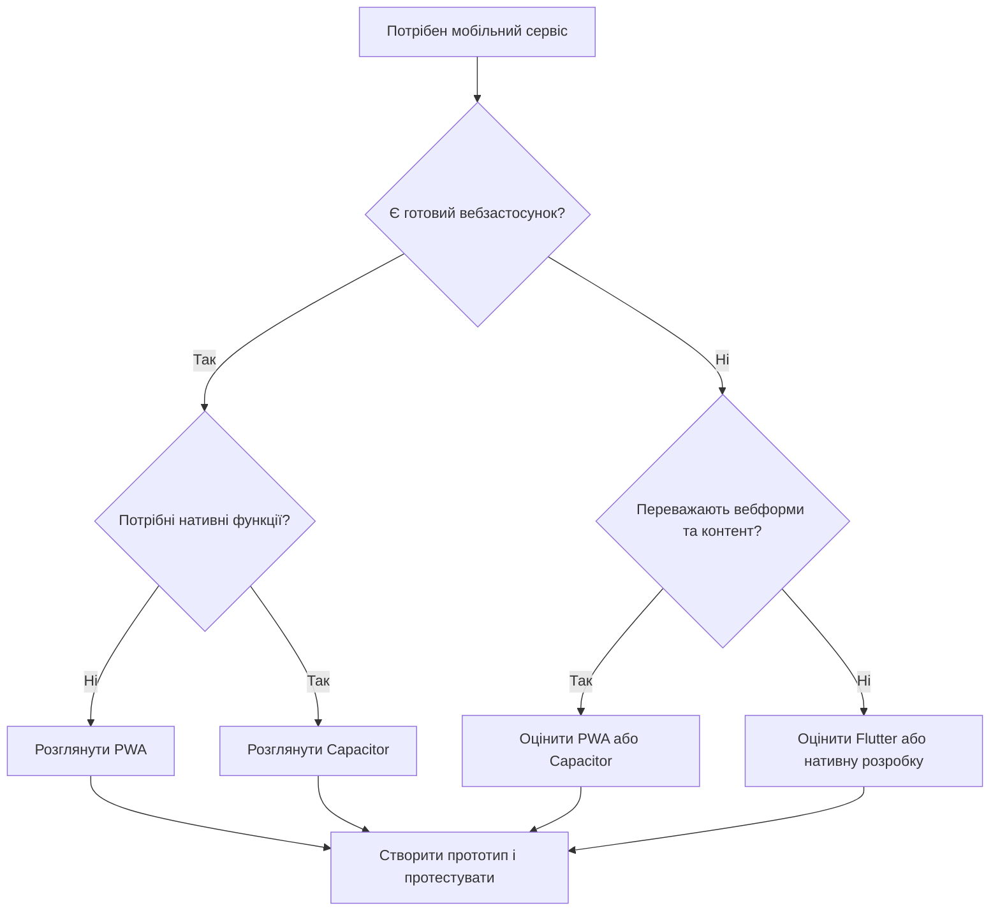

# Практична робота № 1
## Загальний огляд мобільних платформ

**Дисципліна:** Програмування для мобільних платформ  
**Варіант 5:** Гібридний підхід — коли він доречний

## 1. Мета роботи

Мета роботи — дослідити особливості гібридної мобільної розробки, визначити завдання, для яких цей підхід є доцільним, порівняти його з Flutter та сформулювати критерії вибору технології для мобільного застосунку.

## 2. Що таке гібридна мобільна розробка

Гібридна мобільна розробка передбачає використання вебтехнологій, зокрема HTML, CSS і JavaScript, для створення інтерфейсу та логіки застосунку. Такий інтерфейс може працювати всередині WebView — компонента, який відображає вебвміст у мобільному застосунку.

Для доступу до функцій пристрою, наприклад камери, геолокації чи сповіщень, можуть використовуватися спеціальні плагіни. Один із прикладів такого рішення — Capacitor.

Варто розрізняти три поняття:

- **WebView-застосунок** — вебінтерфейс, який відображається у вбудованому браузері.
- **PWA (Progressive Web App)** — вебзастосунок із можливостями, які залежать від браузера та операційної системи. Він може підтримувати встановлення на пристрій і роботу офлайн за відповідної реалізації.
- **Capacitor** — інструмент, який дає змогу використовувати вебтехнології в мобільному застосунку та звертатися до нативних можливостей через плагіни.

Отже, гібридний підхід дає змогу повторно використовувати значну частину вебкоду, але не усуває потреби тестувати застосунок на різних мобільних платформах.

## 3. Архітектура гібридного застосунку

Типовий гібридний застосунок складається з інтерфейсу, логіки, шару взаємодії з платформою та нативних функцій пристрою.

### 3.1. Схема роботи

**Пояснення до діаграми:**

1. Користувач взаємодіє з інтерфейсом застосунку.
2. HTML і CSS відповідають за структуру та оформлення елементів.
3. JavaScript або TypeScript реалізує логіку, перевірку даних і взаємодію з сервером.
4. Capacitor забезпечує зв'язок між вебкодом і можливостями мобільної платформи.
5. Плагіни дають змогу звертатися до доступних нативних функцій Android та iOS.

Не кожна функція обов'язково проходить через нативний плагін. Наприклад, звичайна вебформа може працювати без нього.

## 4. Коли гібридний підхід доречний

### 4.1. Завдання, для яких він підходить

| Клас завдань | Приклад | Чому гібридний підхід доречний |
|---|---|---|
| Каталоги та інформаційні сервіси | Каталог товарів, меню кафе, довідник | Основу становлять текст, зображення, списки та запити до сервера |
| Корпоративні застосунки | Внутрішній портал, перегляд звітів | Можна повторно використовувати вебінтерфейс і спільну бізнес-логіку |
| Форми та облік даних | Реєстрація, заявки, анкети | Такі сценарії зазвичай не потребують складної графіки |
| Сервіси з помірним доступом до пристрою | Фото до заявки, геолокація, сповіщення | Потрібні нативні функції, але їх можна підключати через плагіни |

Гібридний підхід особливо вигідний, коли вже існує вебзастосунок або вебкоманда, а мобільна версія має повторювати основні сценарії. У такому випадку частину коду, стилів і логіки можна використати повторно.

### 4.2. Завдання, для яких він менш доречний

| Клас завдань | Приклад | Чому гібридний підхід може не підійти |
|---|---|---|
| Ігри зі складною 3D-графікою | Гонки, масштабні 3D-сцени | Можуть знадобитися спеціалізований графічний рушій та точний контроль продуктивності |
| Застосунки з дуже високими вимогами до швидкодії | Обробка відео в реальному часі, складні обчислення | Додатковий шар взаємодії та особливості вебсередовища можуть ускладнити оптимізацію |
| Глибока інтеграція з операційною системою | Спеціалізовані системні служби, складна робота з обладнанням | Може знадобитися багато власного нативного коду або функції, яких немає у готових плагінах |

Це не означає, що будь-яку таку програму неможливо створити гібридними засобами. Рішення залежить від конкретних вимог, доступних API та результатів тестування прототипу.

## 5. Порівняння гібридного підходу та Flutter

Flutter — це набір інструментів для створення застосунків із використанням мови Dart. На відміну від типового гібридного рішення на основі WebView, Flutter використовує власну систему побудови інтерфейсу.

| Критерій | Гібридний підхід (Capacitor) | Flutter |
|---|---|---|
| Основні технології | HTML, CSS, JavaScript або TypeScript | Dart і Flutter |
| Продуктивність | Залежить від складності вебінтерфейсу, WebView і плагінів | Дає змогу будувати інтерфейс без типового WebView-шару; швидкодію все одно потрібно вимірювати |
| Доступ до API пристрою | Через Capacitor API та плагіни; для окремих можливостей може знадобитися нативний код | Через плагіни Flutter або власний платформний код |
| Повторне використання вебкоду | Високе, якщо вже є вебзастосунок | Вебінтерфейс зазвичай потрібно реалізовувати засобами Flutter |
| Витрати на підтримку | Можуть бути нижчими за наявності вебкоманди й спільної кодової бази | Потрібні знання Dart і Flutter; перевагою є спільна кодова база для підтримуваних платформ |
| Інтерфейс | HTML/CSS, залежність від WebView та реалізації стилів | Віджети Flutter забезпечують узгоджений вигляд інтерфейсу |
| Коли обирати | Коли важливо використати наявний вебкод | Коли потрібен окремо побудований мобільний інтерфейс і контроль над його поведінкою |

**Важливо:** не можна стверджувати, що одна технологія завжди швидша за іншу. Результат залежить від пристрою, архітектури, складності інтерфейсу та якості реалізації.

### 5.1. Як перевіряти продуктивність

Для об'єктивного порівняння слід створити прототипи з однаковими функціями та перевірити їх на тих самих пристроях.

Рекомендовані показники:

- час запуску застосунку;
- плавність прокручування списків та анімацій;
- використання оперативної пам'яті;
- розмір інсталяційного пакета;
- стабільність роботи під час тривалого використання.

Порівнювати потрібно не лише технології, а й конкретні реалізації. Результати тестування варто записати в таблицю, зазначивши пристрій, версію операційної системи та умови перевірки.

## 6. Алгоритм вибору технології

### 6.1. Схема прийняття рішення

Діаграма є спрощеною моделлю вибору. Остаточне рішення потрібно приймати після уточнення вимог, перевірки потрібних API та тестування на цільових пристроях.

### 6.2. Чекліст: чи варто обирати гібридний підхід?

Гібридний підхід доцільно обирати, якщо на всі п'ять запитань можна відповісти «так».

| № | Контрольне запитання | Умова для відповіді «так» |
|---|---|---|
| 1 | Чи можна реалізувати основні сценарії вебтехнологіями? | Основу становлять форми, списки, контент і взаємодія із сервером |
| 2 | Чи важливе повторне використання вебкоду? | Уже є вебзастосунок або команда з відповідними навичками |
| 3 | Чи доступні потрібні функції пристрою? | Необхідні API підтримуються Capacitor або їх можна реалізувати власним плагіном |
| 4 | Чи відповідає продуктивність вимогам? | Прототип проходить тестування на цільових пристроях |
| 5 | Чи прийнятні обмеження WebView і плагінів? | Команда готова тестувати сумісність та підтримувати залежності |

Якщо хоча б на одне критично важливе запитання відповідь «ні», варто переглянути архітектуру або порівняти гібридний підхід із Flutter чи нативною розробкою.

## 7. Ризики та обмеження

| Ризик | Можливий наслідок | Як зменшити ризик |
|---|---|---|
| Відмінності WebView на пристроях | Інтерфейс може поводитися по-різному | Тестувати на різних версіях Android та iOS |
| Обмеження плагінів | Потрібна додаткова нативна реалізація | Перевіряти доступність API до початку розробки |
| Продуктивність складного інтерфейсу | Затримки анімацій або прокручування | Профілювати застосунок і спрощувати вузькі місця |
| Оновлення залежностей | Можливі проблеми сумісності | Фіксувати версії, перевіряти оновлення та автоматизувати тести |
| Вимоги магазинів застосунків | Публікація може потребувати додаткових змін | Перевіряти актуальні правила Google Play та App Store |

Основний ризик обраного підходу — залежність від WebView і плагінів. Його можна зменшити, якщо заздалегідь перевірити найважливіші функції на реальних пристроях і не відкладати тестування до завершення проєкту.

## 8. Висновок

Для мобільного сервісу, який переважно складається з форм, каталогів, особистого кабінету та взаємодії із сервером, **доцільно обрати гібридний підхід на основі Capacitor**, якщо вже є вебкод або команда, що володіє вебтехнологіями.

Рішення ґрунтується на трьох аргументах:

1. **Повторне використання коду:** можна застосувати наявні HTML, CSS і JavaScript або TypeScript.
2. **Доступ до мобільних можливостей:** Capacitor надає механізм роботи з нативними API через плагіни.
3. **Підтримка проєкту:** спільна вебкодова база може зменшити дублювання логіки та витрати на її оновлення.

Водночас головний ризик — відмінності WebView, обмеження плагінів і можливі проблеми продуктивності. Тому перед повною розробкою потрібно створити прототип, перевірити потрібні API та виміряти продуктивність на цільових пристроях.

Якщо ж застосунок потребує складної графіки, високої продуктивності або специфічної системної інтеграції, варто розглянути Flutter чи нативну розробку.

## 9. Джерела інформації

1. Capacitor — офіційна документація: https://capacitorjs.com/docs
2. Capacitor — налаштування середовища розробки: https://capacitorjs.com/docs/getting-started/environment-setup
3. Capacitor — Progressive Web Apps: https://capacitorjs.com/docs/web/progressive-web-apps
4. Flutter — продуктивність застосунків: https://docs.flutter.dev/perf
5. Flutter — архітектура застосунків: https://docs.flutter.dev/app-architecture
6. MDN Web Docs — Progressive Web Apps: https://developer.mozilla.org/en-US/docs/Web/Progressive_web_apps

**Дата звернення до джерел:** 21.10.2026.

Інформація в роботі узагальнена за офіційною документацією зазначених технологій. Оцінки продуктивності та витрат на підтримку залежать від конкретного проєкту й мають перевірятися на практиці.